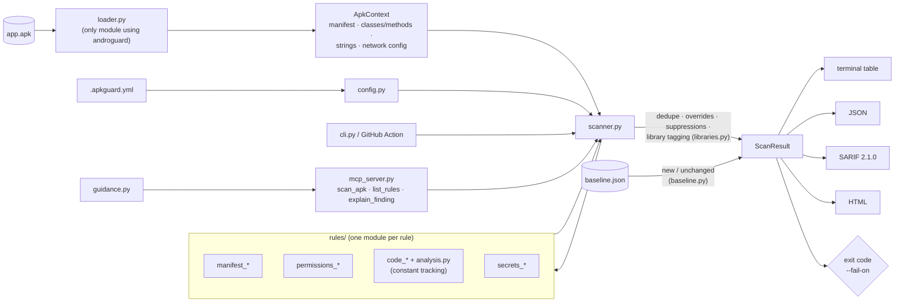

# APKGuard

[](https://github.com/YOUR_GITHUB_USER/apkguard/actions/workflows/ci.yml)


[](LICENSE)

**Static security scanner for Android APKs, built to run in CI/CD pipelines.**

APKGuard inspects a compiled `.apk` (manifest, Dalvik bytecode, resources and assets) and reports
security issues *before* you ship: debuggable builds, cleartext traffic, exported components,
weak crypto, TLS validation bypasses, hardcoded secrets and more. It writes terminal, JSON,
SARIF and HTML output, and its exit code gates a release.

- **CI-native.** Exit codes, a `--fail-on` threshold, SARIF for GitHub code scanning, a ready-made
  GitHub Action, and **baselines** so a PR only fails on *new* findings.
- **Low-noise by default.** Findings inside AndroidX, Kotlin, OkHttp and other third-party
  libraries are reported separately and don't fail the build. That's a third of all findings
  on real apps.
- **Actionable.** Every finding has a location, evidence, remediation, CWE and OWASP MASVS
  references, plus triage guidance (how to verify it, when it is usually benign).
- **Evaluated on real apps.** Scanned 50 F-Droid apps with a manual review of the findings.
  The [results](EVALUATION.md) are published, false positives included.
- **AI-assistant ready.** An optional [MCP](https://modelcontextprotocol.io) server lets Claude
  Desktop, Claude Code and other MCP clients scan APKs and explain findings.

> APKGuard is a static, heuristic scanner. It catches common misconfigurations and insecure API
> usage. It does not replace a manual security review or dynamic testing.

---

## Contents

[Quick start](#quick-start) · [Example](#example-output) · [Evaluation](#evaluation-on-50-real-apps) ·
[Rules](#rules) · [Exit codes](#exit-codes-and-thresholds) · [Configuration](#configuration) ·
[CI and baselines](#ci-usage) · [MCP server](#use-with-ai-assistants-mcp) ·
[Architecture](#architecture) · [Limitations](#limitations) · [Development](#development) ·
[Roadmap](#roadmap)

## Quick start

```bash
pip install apkguard                 # Python 3.10+  (or: pip install . from a clone)
apkguard scan app-release.apk
```

```bash
# All reports at once; fail the build on medium or worse
apkguard scan app.apk --fail-on medium \
  --sarif apkguard.sarif --html apkguard-report.html --json apkguard.json

apkguard rules                       # list all rules
```

With Docker:

```bash
docker build -t apkguard .
docker run --rm -v "$PWD:/work" apkguard scan app.apk --html report.html
```

## Example output

Scanning [Hauk](https://f-droid.org/packages/info.varden.hauk/) 1.6.3, a location-sharing app
from the evaluation set (real output, rendered at 130 columns; info rows hidden with
`--min-severity low`):

```text
$ apkguard scan info.varden.hauk_15.apk --min-severity low
APKGuard 0.1.0  info.varden.hauk  1.6.3  minSdk=24 targetSdk=36
┏━━━━━━━━━━┳━━━━━━━━━━━━━┳━━━━━━━━━━━━━━━━━━━━━━━━━━━━━━━━━━┳━━━━━━━━━━━━━━━━━━━━━━━━━━━━━━━━━┳━━━━━━━━━━━━━━━━━━━━━━━━━━━━━━━━━━┓
┃ Severity ┃ Rule        ┃ Title                            ┃ Location                        ┃ Details                          ┃
┡━━━━━━━━━━╇━━━━━━━━━━━━━╇━━━━━━━━━━━━━━━━━━━━━━━━━━━━━━━━━━╇━━━━━━━━━━━━━━━━━━━━━━━━━━━━━━━━━╇━━━━━━━━━━━━━━━━━━━━━━━━━━━━━━━━━━┩
│ HIGH     │ AG-CODE-009 │ Insecure HostnameVerifier        │ classes.dex:Linfo/varden/hauk/h │ Linfo/varden/hauk/http/security/ │
│          │             │                                  │ ttp/security/InsecureHostnameVe │ InsecureHostnameVerifier;.verify │
│          │             │                                  │ rifier;->verify                 │ () always returns true.          │
│ HIGH     │ AG-MAN-003  │ Cleartext network traffic        │ res/ad.xml:base-config          │ The network security config      │
│          │             │ allowed                          │                                 │ base-config allows cleartext     │
│          │             │                                  │                                 │ traffic for all domains.         │
│ MEDIUM   │ AG-MAN-004  │ Exported component without       │ AndroidManifest.xml:info.varden │ receiver                         │
│          │             │ permission                       │ .hauk.global.Receiver           │ info.varden.hauk.global.Receiver │
│          │             │                                  │                                 │ is exported                      │
│          │             │                                  │                                 │ (android:exported="true")        │
│          │             │                                  │                                 │ without a permission.            │
│ LOW      │ AG-MAN-002  │ Application data backup is       │ AndroidManifest.xml:application │ The <application> element sets   │
│          │             │ enabled                          │                                 │ android:allowBackup="true".      │
│          │             │                                  │                                 │ Backup rules                     │
│          │             │                                  │                                 │ (fullBackupContent/dataExtractio │
│          │             │                                  │                                 │ nRules) are defined; verify they │
│          │             │                                  │                                 │ exclude sensitive data.          │
└──────────┴─────────────┴──────────────────────────────────┴─────────────────────────────────┴──────────────────────────────────┘
Summary: high: 2, medium: 1, low: 1, info: 3  (6.86s)
Not shown: 24 finding(s) in third-party libraries (androidx 22, kotlin 1, kotlinx 1). They do not affect the exit code; use
--library-findings include to list them.
FAIL: 2 finding(s) at or above severity 'high'.
```

The `InsecureHostnameVerifier` was confirmed in the bytecode (`verify()` is `return true`). The
24 library findings, mostly reflection inside AndroidX, stay in the reports but out of the way.
The reports from this scan are in [`docs/`](docs/):
[HTML](docs/example-report.html), [SARIF](docs/example-report.sarif), [JSON](docs/example-report.json).
The HTML report is a single self-contained file (no external scripts, fonts or styles) with dark
mode, severity filters and text search.

## Evaluation on 50 real apps

APKGuard was run on 50 benign open-source apps from F-Droid (one per category, 0.3–6 MB, pinned
by SHA-256 and re-downloadable with one script). Full write-up: **[EVALUATION.md](EVALUATION.md)**.

| | Result |
|---|---|
| APKs scanned without errors | **50 / 50** |
| Scan time per APK | median **5.4 s**, max 13.2 s (apps with ~7,000–8,700 classes) |
| Findings incl. library code → app code only (default) | 737 → **492** (−33% from library detection) |
| High-severity findings → in app code | 19 → **14** |
| Manual review of 23 findings | 8 true positives, 13 correct but not actionable, **2 false positives** |
| Bugs found and fixed through the evaluation | 2 (a false "hardcoded key", duplicate fingerprints) |
| Baselines across 42 real upgrades | 75% of findings matched; **1 of 42** upgrades would fail the default gate |

Detection is accurate: 21 of the 23 reviewed findings describe code or configuration that really
is there. The weak spots are *actionability* (library code, behaviour that is intended for that
kind of app) and conditions the analysis ignores: both false positives were Cordova code behind
a condition (a debug-build check and an opt-in preference). Real issues found include a hostname verifier that accepts every
certificate, a trust-all `TrustManager`, an unprotected exported service in a contacts app, a third-party API
secret shipped in resources, and test code (`androidx.test`) shipped in a release build.

## Rules

| ID | Title | Default severity | CWE | Apps flagged in evaluation¹ |
|---|---|---|---|---:|
| `AG-MAN-001` | Application is debuggable | high | CWE-489 | 0 |
| `AG-MAN-002` | Application data backup is enabled | medium | CWE-530 | 37 |
| `AG-MAN-003` | Cleartext network traffic allowed | high | CWE-319 | 9 |
| `AG-MAN-004` | Exported component without permission | medium | CWE-926 | 22 |
| `AG-MAN-005` | Outdated SDK version | medium | CWE-1104 | 14 |
| `AG-PERM-001` | Dangerous or high-risk permissions requested | info | CWE-250 | 33 |
| `AG-PERM-002` | Suspicious permission combination | high | CWE-250 | 2 |
| `AG-CODE-001` | Dynamic code loading | high | CWE-829 | 1 |
| `AG-CODE-002` | Reflection-heavy code | low | CWE-470 | 36 |
| `AG-CODE-003` | WebView JavaScript interface exposed | medium | CWE-749 | 2 |
| `AG-CODE-004` | Insecure WebView configuration | high | CWE-295 | 6 |
| `AG-CODE-005` | Weak cipher or cipher mode | medium | CWE-327 | 0 |
| `AG-CODE-006` | Weak hash algorithm | medium | CWE-328 | 5 |
| `AG-CODE-007` | Hardcoded cryptographic key or IV | high | CWE-321 | 0 |
| `AG-CODE-008` | Insecure TrustManager | high | CWE-295 | 1 |
| `AG-CODE-009` | Insecure HostnameVerifier | high | CWE-297 | 1 |
| `AG-SEC-001` | Hardcoded secret | high | CWE-798 | 1 |

¹ Out of 50 F-Droid apps, counting app code only (the default). Rules that never fire on benign
apps are covered by unit tests with synthetic bytecode.

The default severity is a starting point. Some rules adjust it per finding: an exported content
provider is *high* but an exported activity is *low*, `DES` is *high* but `AES/ECB` is *medium*,
and `setJavaScriptEnabled(true)` is *info*. Every rule also maps to an OWASP MASVS control; run
`apkguard rules` for the live list.

<details>
<summary>What each rule detects</summary>

- **AG-MAN-001**: `android:debuggable="true"`.
- **AG-MAN-002**: `allowBackup` true or missing. Severity is lowered when `fullBackupContent` / `dataExtractionRules` are set.
- **AG-MAN-003**: `usesCleartextTraffic="true"`, `targetSdk < 28` with no opt-out, or a network security config with `cleartextTrafficPermitted="true"`, either in `base-config` or in a `domain-config` (lower severity, domains listed).
- **AG-MAN-004**: components exported explicitly or implicitly (intent filter; providers on targetSdk ≤ 16) with no permission, or only a `normal`/`dangerous` custom permission. Launcher activities are ignored.
- **AG-MAN-005**: `targetSdkVersion` < 34 (high if < 28) and `minSdkVersion` < 23. Thresholds are configurable.
- **AG-PERM-001**: runtime permissions (info) and high-risk special permissions such as `SYSTEM_ALERT_WINDOW`, `REQUEST_INSTALL_PACKAGES`, accessibility or notification-listener services (medium).
- **AG-PERM-002**: combinations such as SMS read + INTERNET + BOOT_COMPLETED, SEND_SMS + INTERNET, overlay + package installs, accessibility + overlay.
- **AG-CODE-001**: `DexClassLoader`, `InMemoryDexClassLoader`, `DexFile`, `PathClassLoader`.
- **AG-CODE-002**: classes with many reflective calls (default ≥ 8), and reflection into non-SDK internals (`android.app.ActivityThread`, `com.android.internal.*`).
- **AG-CODE-003**: `addJavascriptInterface` (high when minSdk < 17).
- **AG-CODE-004**: `setAllowUniversalAccessFromFileURLs(true)`, `setAllowFileAccessFromFileURLs(true)`, `MIXED_CONTENT_ALWAYS_ALLOW`, `SslErrorHandler.proceed()` in `onReceivedSslError`, and `setJavaScriptEnabled(true)` (info).
- **AG-CODE-005**: `Cipher.getInstance` with DES/3DES/RC4/Blowfish/RC2, ECB mode, a bare `"AES"` (defaults to ECB), or unpadded RSA.
- **AG-CODE-006**: `MessageDigest`/`Mac` with MD2/MD4/MD5 (medium) or SHA-1/HmacMD5 (low).
- **AG-CODE-007**: `SecretKeySpec`, `PBEKeySpec`, `DESKeySpec`, `IvParameterSpec`, `GCMParameterSpec` built from string literals (`"…".getBytes()`, `toCharArray`, `Base64.decode`) or array literals.
- **AG-CODE-008**: `X509TrustManager.checkServerTrusted` with an empty body.
- **AG-CODE-009**: `HostnameVerifier.verify` that always returns `true`, `ALLOW_ALL_HOSTNAME_VERIFIER`, and `AllowAllHostnameVerifier`.
- **AG-SEC-001**: private keys, AWS, GitHub, Slack, Stripe, OpenAI, Anthropic, SendGrid, Twilio and Google API keys, JWTs, credentials in URLs, plus high-entropy values in secret-looking resource names. Sources are code strings, `strings.xml`, and text files in `assets/` and `res/raw/`. Secrets are redacted in all reports.

</details>

## Exit codes and thresholds

| Code | Meaning |
|---|---|
| `0` | Scan finished. No finding counts against the threshold. |
| `1` | At least one finding at or above `--fail-on` that is not suppressed, not in library code (default mode) and not in the baseline. |
| `2` | Usage or configuration error (unknown rule ID, invalid `.apkguard.yml`, missing baseline, ...). |
| `3` | The APK could not be read or parsed. |

`--fail-on` accepts `info`, `low`, `medium`, `high` (default), `critical` or `none`. The CLI flag
overrides `fail_on` in the config file.

## Configuration

APKGuard reads `.apkguard.yml` from the current directory, or the file you pass with `--config`.
See [`examples/.apkguard.yml`](examples/.apkguard.yml) for a commented example.

```yaml
fail_on: high
disable: [AG-PERM-001]
severity_overrides:
  AG-MAN-005: low
library_findings: separate   # separate | include | exclude (see below)
library_packages:            # extra third-party packages, on top of the built-in list
  - com.vendor.sdk
exclude_packages:            # skip these classes entirely in code/secret rules
  - com.example.generated
rule_options:
  AG-CODE-002: { threshold: 12 }
suppress:
  - rule: AG-MAN-004
    location: "com.example.app.DeepLinkActivity"   # glob on file, symbol or file:symbol
    reason: "Public deep link, input validated"
```

Suppressed findings stay in the JSON, HTML and SARIF reports (SARIF `suppressions`) for
auditability, but never fail the build. Unknown keys and rule IDs are rejected, so typos don't
silently disable checks.

### Third-party library findings

Most apps bundle large libraries (AndroidX, Kotlin, Google Play services, OkHttp, ...). Rules
fire inside them too, but you can't fix that code, so APKGuard recognises findings located in
[well-known library packages](src/apkguard/libraries.py) and handles them according to
`--library-findings` (or `library_findings:` in the config):

| Mode | Behaviour |
|---|---|
| `separate` (default) | Library findings stay in the JSON/HTML/SARIF reports, tagged with the library (`"origin": "library"`), but are left out of the terminal table and summary, and never fail the build. SARIF marks them as suppressed. |
| `include` | Library findings are treated exactly like findings in app code. |
| `exclude` | Library findings are dropped from all output. |

Add your own vendored SDKs with `--library-package com.vendor.sdk` or `library_packages:`. Code
inside the app's own package is never treated as library code. In the
[evaluation](EVALUATION.md#library-detection) this cut findings by 33% and code findings by 47%.
It cannot recognise library code that R8 has renamed (`La2;`), so obfuscated apps still show
some library findings.

`exclude_packages` is different: it skips classes *before* analysis (faster, but they are
invisible in every report). Use it only for code you never want to scan.

## CI usage

### GitHub Actions

```yaml
permissions:
  contents: read
  security-events: write          # for SARIF upload

jobs:
  apkguard:
    runs-on: ubuntu-latest
    steps:
      - uses: actions/checkout@v4
      - run: ./gradlew assembleRelease
      - uses: YOUR_GITHUB_USER/apkguard@v0.1.0
        with:
          apk: app/build/outputs/apk/release/app-release-unsigned.apk
          fail-on: high
          baseline: apkguard-baseline.json   # optional, see below
          html-file: apkguard-report.html
```

The action installs APKGuard, writes a SARIF report, uploads it to **GitHub code scanning**
(findings show up in the *Security* tab and as PR annotations), and *then* fails the job if the
threshold is exceeded, so results are visible even on failing builds. Inputs: `apk`, `fail-on`,
`config`, `baseline`, `library-findings`, `sarif-file`, `html-file`, `json-file`, `upload-sarif`,
`python-version`. Output: `exit-code`. All inputs reach the shell through environment variables,
never through `${{ }}` interpolation. A full workflow is in
[`examples/github-workflow.yml`](examples/github-workflow.yml).

### Baselines: fail only on new findings

Turning on a scanner in an existing project usually means dozens of findings on day one. A
baseline records them as accepted, so CI only fails when a change introduces something *new*:

```bash
# once: accept the current state (always exits 0) and commit the file
apkguard scan app-release.apk --write-baseline apkguard-baseline.json
git add apkguard-baseline.json

# in CI: findings in the baseline are "unchanged" and never fail the build
apkguard scan app-release.apk --baseline apkguard-baseline.json --fail-on medium
```

For example, with a baseline from [Hauk](https://f-droid.org/packages/info.varden.hauk/) 1.6.2,
scanning 1.6.3 shows only what changed: the release added a notification permission (real
output, table trimmed):

```text
$ apkguard scan info.varden.hauk_14.apk -q --write-baseline apkguard-baseline.json
Wrote baseline with 31 finding(s) to apkguard-baseline.json
$ apkguard scan info.varden.hauk_15.apk --baseline apkguard-baseline.json --fail-on medium
│ INFO     │ AG-PERM-001 │ Dangerous or high-risk permissions requested │ AndroidManifest.xml:android.permission.POST_NOTIFICATIONS │
Summary: info: 1  (6.98s)
Not shown: 24 finding(s) in third-party libraries (androidx 22, kotlin 1, kotlinx 1). ...
Baseline: 1 new, 30 unchanged (not shown, do not affect the exit code), 1 no longer present.
$ echo $?
0
```

With the GitHub Action, pass `baseline: apkguard-baseline.json`. Unchanged findings are hidden
from the table, marked `"baseline_state": "unchanged"` in JSON, and get SARIF's own
`baselineState`. The summary also counts baseline entries that are gone (fixed). Findings are
matched by their fingerprint (rule + location + evidence, ignoring message wording, severity and
which `classesN.dex` a class is in). The baseline file lists rule, severity and location next to
each fingerprint, so it can be reviewed in a pull request. Regenerate it when you deliberately
accept new findings.

How well does it hold up? Across 42 real F-Droid upgrades (baseline from the previous release,
scan of the new one), 75% of findings matched and 19 apps had no new findings at all; only 1 of
42 upgrades would have failed the default `--fail-on high` gate. The catch is R8 obfuscation:
when class names change between builds, findings in renamed classes show up as new. That was
about 95% of the "new" findings, mostly low-severity reflection
([details](EVALUATION.md#baselines-across-real-releases)).

### Any other CI (GitLab, Jenkins, Azure, ...)

```bash
pip install apkguard
apkguard scan app/build/outputs/apk/release/app-release.apk \
  --fail-on high --baseline apkguard-baseline.json --sarif apkguard.sarif --html apkguard-report.html
```

## Use with AI assistants (MCP)

APKGuard ships an optional [Model Context Protocol](https://modelcontextprotocol.io) server, so
assistants such as Claude Desktop and Claude Code can scan APKs and explain findings for you.

```bash
pip install "apkguard[mcp]"     # adds the official MCP Python SDK and the apkguard-mcp command
```

| Tool | What it returns |
|---|---|
| `scan_apk(apk_path, min_severity="low", library_findings="separate", max_findings=50, config_path=None)` | Package info, counts per severity, and the findings (rule, severity, location, evidence, remediation, fingerprint, library), most severe first |
| `list_rules(category=None)` | The rule catalogue with severity, CWE and OWASP MASVS IDs |
| `explain_finding(rule_id, location=None)` | Description, remediation, how to verify the finding, when it is usually benign, references, and a ready-to-paste `.apkguard.yml` suppression |

All tools are read-only and return structured JSON (typed output schemas). Errors such as a
missing file come back as tool errors the assistant can read.

**Claude Code:**

```bash
claude mcp add apkguard -- apkguard-mcp
# or share it with your team through the project's .mcp.json:
claude mcp add --scope project apkguard -- apkguard-mcp
```

**Claude Desktop:** add the server to `claude_desktop_config.json` (Settings → Developer → Edit
Config; on Windows the file is in `%APPDATA%\Claude\`, on macOS in
`~/Library/Application Support/Claude/`) and restart the app:

```json
{
  "mcpServers": {
    "apkguard": {
      "command": "apkguard-mcp"
    }
  }
}
```

If `apkguard-mcp` is not on the `PATH` that Claude Desktop sees (common with virtual
environments), use the full path, e.g. `"C:\\path\\to\\.venv\\Scripts\\apkguard-mcp.exe"` (JSON
needs doubled backslashes) or `"/path/to/.venv/bin/apkguard-mcp"`. Then ask something like
*"Scan ~/Downloads/app-release.apk and explain the high-severity findings"*. Pass absolute
paths: the server resolves relative paths against its own working directory.

> **Prompt-injection note.** Finding messages and evidence contain text from the APK (component
> names, string constants) that the APK's author controls. The server tells clients to treat
> them as data, but be careful when scanning APKs you don't trust with an assistant that can
> also take actions.

## Architecture



- **`loader.py`** is the only module that touches androguard. It converts the APK into a plain
  `ApkContext`: the decoded manifest as an lxml tree, every class/method with simplified Dalvik
  instructions, resource and asset strings, and the network security config.
- **`analysis.py`** makes a single linear pass per method and tracks constants in registers
  (ints, strings, byte arrays derived from string literals). Rules use it to answer questions
  such as "is the argument to `Cipher.getInstance` the literal `AES/ECB/...`?"
- **`rules/`** holds one module per rule: a `RuleMeta` (ID, title, severity, CWE, MASVS,
  description, remediation, references) and a `check(ctx)` generator. Rules only see
  `ApkContext`, so unit tests build contexts synthetically, with no APK needed.
- **`scanner.py`** runs the rules, isolates rule crashes (reported, never fatal), merges
  duplicate fingerprints, applies the config and tags library findings (**`libraries.py`**).
  `ScanResult.gating_findings` is the single definition of "what counts" for the summary and
  the exit code.
- **`baseline.py`** writes and compares baseline files by fingerprint.
- **`reporters/`** render a `ScanResult` as a terminal table, JSON, SARIF 2.1.0 (validated
  against the official schema in tests) and standalone HTML.
- **`mcp_server.py`** exposes the same scanner as MCP tools. **`guidance.py`** holds per-rule
  triage advice.

Design decisions, with the reasoning and trade-offs behind each, are in
[DECISIONS.md](DECISIONS.md).

## Limitations

- **Intra-procedural, flow-insensitive analysis.** Constants are tracked within one method and
  conditions are ignored. Values passed through fields or other methods are missed, and code
  behind a condition (a debug-build check, an opt-in setting) is still reported. Both false
  positives in the evaluation were of this kind.
- **Library detection uses package names.** Library code renamed by R8/ProGuard (`La2;`) is
  treated as app code; in the evaluation, 253 of the remaining app findings were in such
  classes, mostly reflection. Conversely, a real issue inside a library package (test code
  shipped in a release) is separated, not dropped.
- **Baselines depend on stable names.** Findings in obfuscated classes can appear as new when
  the obfuscation mapping changes between builds.
- **Severity is per pattern, not per data flow.** An exported provider is *high* even when it
  only serves public data.
- **Recall is not measured.** The evaluation used benign apps; rules for patterns that rarely
  occur there (hardcoded keys, `debuggable`) are tested with synthetic bytecode only.
- **APK input only**: no AAB, no native (`.so`) analysis, no Kotlin/Java source analysis.

## Development

```bash
python -m venv .venv && . .venv/bin/activate      # Windows: .venv\Scripts\activate
pip install -e ".[dev]"                             # includes the MCP extra, build and twine
ruff check src tests evaluation && ruff format --check src tests evaluation
mypy src evaluation                                 # strict mode
pytest --cov=apkguard                               # unit + integration tests
```

Reproduce the evaluation (downloads ~300 MB from f-droid.org, verified by SHA-256):

```bash
python evaluation/fetch_apks.py
python evaluation/run_evaluation.py       # per-rule results -> evaluation/results/
python evaluation/run_baseline_eval.py    # baselines across real releases
```

Test fixtures are small, benign GPL apps from F-Droid; see
[`tests/fixtures/apks/README.md`](tests/fixtures/apks/README.md). Contributions are welcome: see
[CONTRIBUTING.md](CONTRIBUTING.md) (adding a rule, reporting false positives) and
[SECURITY.md](SECURITY.md).

## Roadmap

- [x] Baselines (`--baseline`) so PRs fail only on new findings
- [x] Third-party library separation
- [x] MCP server for AI assistants
- [ ] Obfuscation-aware library detection (code fingerprints, as in LibScout/LibID)
- [ ] Branch-aware constant tracking, so code guarded by `FLAG_DEBUGGABLE` or a preference is
      recognised (the main false-positive source in the evaluation)
- [ ] Read the R8 `mapping.txt` to fingerprint original class names, so baselines survive
      obfuscation changes
- [ ] Recognise components the system must reach (sync adapters, authenticators, media buttons)
      in AG-MAN-004
- [ ] Inter-procedural constant tracking (keys passed through fields or helper methods)
- [ ] More rules: `PendingIntent` mutability, `MODE_WORLD_READABLE`, SQL injection in
      `rawQuery`, logging of secrets, `FileProvider` root paths, Firebase open database URLs,
      native library hardening (NX, PIE, RELRO)
- [ ] AAB (Android App Bundle) input
- [ ] Network security config: user-trusted CAs, pin-set expiry
- [ ] Rule plugins via Python entry points

## License

Apache License 2.0. See [LICENSE](LICENSE). The F-Droid apps used as test fixtures and in the
evaluation keep their own licenses and are not distributed with the package.
