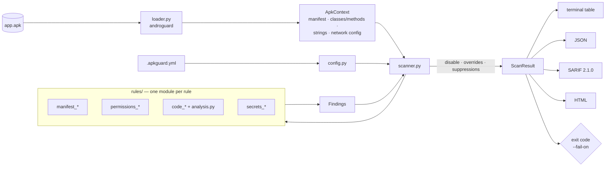

# APKGuard

**Static security scanner for Android APKs, built to run in CI/CD pipelines.**

APKGuard inspects a compiled `.apk` (manifest, Dalvik bytecode, resources and assets) and reports
security issues *before* you ship: debuggable builds, cleartext traffic, exported components,
weak crypto, TLS validation bypasses, hardcoded secrets and more. It produces terminal, JSON,
SARIF and HTML output, and its exit code and `--fail-on` threshold make it easy to gate a release.

- **Fast.** No decompilation to Java. A small app scans in under a second.
- **CI-native.** Exit codes, a severity threshold, SARIF for GitHub code scanning, and a ready-made GitHub Action.
- **Actionable.** Every finding includes a location, evidence, remediation advice, CWE and OWASP MASVS references.
- **Configurable.** Disable rules, override severities, exclude third-party packages and suppress accepted findings in `.apkguard.yml`.

> APKGuard is a static, heuristic scanner. It catches common misconfigurations and insecure API
> usage. It does not replace a manual security review or dynamic testing.

---

## Quick start

```bash
pip install .            # from a clone of this repository (Python 3.10+)
apkguard scan app-release.apk
```

```bash
# All reports at once; fail the build on medium or worse
apkguard scan app.apk --fail-on medium \
  --sarif apkguard.sarif --html apkguard-report.html --json apkguard.json

apkguard rules           # list all rules
```

With Docker:

```bash
docker build -t apkguard .
docker run --rm -v "$PWD:/work" apkguard scan app.apk --html report.html
```

## Example output

Scanning [Notes](https://github.com/billthefarmer/notes) from F-Droid, one of the test fixtures (columns trimmed for width):

```text
$ apkguard scan org.billthefarmer.notes_141.apk
APKGuard 0.1.0  org.billthefarmer.notes  1.41  minSdk=23 targetSdk=35
┌──────────┬─────────────┬──────────────────────────────────┬──────────────────────────────────────┬──────────────────────────────────────────┐
│ Severity │ Rule        │ Title                            │ Location                             │ Details                                  │
├──────────┼─────────────┼──────────────────────────────────┼──────────────────────────────────────┼──────────────────────────────────────────┤
│ HIGH     │ AG-MAN-003  │ Cleartext network traffic        │ AndroidManifest.xml:application      │ The <application> element sets           │
│          │             │ allowed                          │                                      │ android:usesCleartextTraffic="true".     │
│ MEDIUM   │ AG-MAN-002  │ Application data backup is       │ AndroidManifest.xml:application      │ The <application> element sets           │
│          │             │ enabled                          │                                      │ android:allowBackup="true". No backup    │
│          │             │                                  │                                      │ rules restrict which files are included. │
│ MEDIUM   │ AG-PERM-001 │ Dangerous or high-risk           │ AndroidManifest.xml:android.permissi │ Requests high-risk permission            │
│          │             │ permissions requested            │ on.MANAGE_EXTERNAL_STORAGE           │ android.permission.MANAGE_EXTERNAL_STORA │
│          │             │                                  │                                      │ GE: allows the app to read and write all │
│          │             │                                  │                                      │ files on shared storage.                 │
│ LOW      │ AG-MAN-004  │ Exported component without       │ AndroidManifest.xml:org.billthefarme │ activity org.billthefarmer.notes.Shortcu │
│          │             │ permission                       │ r.notes.Shortcut                     │ t is exported (android:exported="true")  │
│          │             │                                  │                                      │ without a permission.                    │
│ INFO     │ AG-CODE-004 │ Insecure WebView configuration   │ classes.dex:Lorg/billthefarmer/notes │ ...->onCreate calls                      │
│          │             │                                  │ /Notes;->onCreate                    │ WebSettings.setJavaScriptEnabled(true),  │
│          │             │                                  │                                      │ which runs JavaScript from loaded pages; │
│          │             │                                  │                                      │ make sure only trusted HTTPS content is  │
│          │             │                                  │                                      │ loaded.                                  │
│ INFO     │ AG-PERM-001 │ Dangerous or high-risk ...       │ ...READ_EXTERNAL_STORAGE             │ Requests dangerous (runtime) permission  │
│ INFO     │ AG-PERM-001 │ Dangerous or high-risk ...       │ ...WRITE_EXTERNAL_STORAGE            │ Requests dangerous (runtime) permission  │
└──────────┴─────────────┴──────────────────────────────────┴──────────────────────────────────────┴──────────────────────────────────────────┘
Summary: high: 1, medium: 2, low: 1, info: 3  (0.46s)
FAIL: 1 finding(s) at or above severity 'high'.
$ echo $?
1
```

Sample reports generated from the Diary fixture are in [`docs/`](docs/):
[HTML](docs/example-report.html), [SARIF](docs/example-report.sarif), [JSON](docs/example-report.json).
The HTML report is a single self-contained file: no external scripts, fonts or styles, and it
supports dark mode, severity filters and text search.

## Rules

| ID | Title | Default severity | Category | CWE |
|---|---|---|---|---|
| `AG-MAN-001` | Application is debuggable | high | manifest | CWE-489 |
| `AG-MAN-002` | Application data backup is enabled | medium | manifest | CWE-530 |
| `AG-MAN-003` | Cleartext network traffic allowed | high | manifest | CWE-319 |
| `AG-MAN-004` | Exported component without permission | medium | manifest | CWE-926 |
| `AG-MAN-005` | Outdated SDK version | medium | manifest | CWE-1104 |
| `AG-PERM-001` | Dangerous or high-risk permissions requested | info | permissions | CWE-250 |
| `AG-PERM-002` | Suspicious permission combination | high | permissions | CWE-250 |
| `AG-CODE-001` | Dynamic code loading | high | code | CWE-829 |
| `AG-CODE-002` | Reflection-heavy code | low | code | CWE-470 |
| `AG-CODE-003` | WebView JavaScript interface exposed | medium | code | CWE-749 |
| `AG-CODE-004` | Insecure WebView configuration | high | code | CWE-295 |
| `AG-CODE-005` | Weak cipher or cipher mode | medium | code | CWE-327 |
| `AG-CODE-006` | Weak hash algorithm | medium | code | CWE-328 |
| `AG-CODE-007` | Hardcoded cryptographic key or IV | high | code | CWE-321 |
| `AG-CODE-008` | Insecure TrustManager | high | code | CWE-295 |
| `AG-CODE-009` | Insecure HostnameVerifier | high | code | CWE-297 |
| `AG-SEC-001` | Hardcoded secret | high | secrets | CWE-798 |

The default severity is a starting point. Some rules adjust it per finding: an exported content
provider is *high* but an exported activity is *low*, `DES` is *high* but `AES/ECB` is *medium*,
and `setJavaScriptEnabled(true)` is *info*. Run `apkguard rules` for the live list.

<details>
<summary>What each rule detects</summary>

- **AG-MAN-001**: `android:debuggable="true"`.
- **AG-MAN-002**: `allowBackup` true or missing. Severity is lowered when `fullBackupContent` / `dataExtractionRules` are set.
- **AG-MAN-003**: `usesCleartextTraffic="true"`, `targetSdk < 28` with no opt-out, or a network security config with `cleartextTrafficPermitted="true"`, either in `base-config` or in a `domain-config` (lower severity, domains listed).
- **AG-MAN-004**: components exported explicitly or implicitly (intent filter; providers on targetSdk ≤ 16) with no permission, or only a `normal`/`dangerous` custom permission. Launcher activities are ignored.
- **AG-MAN-005**: `targetSdkVersion` < 34 (high if < 28) and `minSdkVersion` < 23. Thresholds are configurable.
- **AG-PERM-001**: runtime permissions (info) and high-risk special permissions such as `SYSTEM_ALERT_WINDOW`, `REQUEST_INSTALL_PACKAGES`, accessibility or notification-listener services (medium).
- **AG-PERM-002**: combinations such as SMS read + INTERNET + BOOT_COMPLETED, SEND_SMS + INTERNET, overlay + package installs, accessibility + overlay.
- **AG-CODE-001**: `DexClassLoader`, `InMemoryDexClassLoader`, `DexFile`, `PathClassLoader`.
- **AG-CODE-002**: classes with many reflective calls (default ≥ 8), and reflection into non-SDK internals (`android.app.ActivityThread`, `com.android.internal.*`).
- **AG-CODE-003**: `addJavascriptInterface` (high when minSdk < 17).
- **AG-CODE-004**: `setAllowUniversalAccessFromFileURLs(true)`, `setAllowFileAccessFromFileURLs(true)`, `MIXED_CONTENT_ALWAYS_ALLOW`, `SslErrorHandler.proceed()` in `onReceivedSslError`, and `setJavaScriptEnabled(true)` (info).
- **AG-CODE-005**: `Cipher.getInstance` with DES/3DES/RC4/Blowfish/RC2, ECB mode, a bare `"AES"` (defaults to ECB), or unpadded RSA.
- **AG-CODE-006**: `MessageDigest`/`Mac` with MD2/MD4/MD5 (medium) or SHA-1/HmacMD5 (low).
- **AG-CODE-007**: `SecretKeySpec`, `PBEKeySpec`, `DESKeySpec`, `IvParameterSpec`, `GCMParameterSpec` built from string literals (`getBytes`, `toCharArray`, `Base64.decode`) or array literals.
- **AG-CODE-008**: `X509TrustManager.checkServerTrusted` with an empty body.
- **AG-CODE-009**: `HostnameVerifier.verify` that always returns `true`, `ALLOW_ALL_HOSTNAME_VERIFIER`, and `AllowAllHostnameVerifier`.
- **AG-SEC-001**: private keys, AWS, GitHub, Slack, Stripe, OpenAI, Anthropic, SendGrid, Twilio and Google API keys, JWTs, credentials in URLs, plus high-entropy values in secret-looking resource names. Sources are code strings, `strings.xml`, and text files in `assets/` and `res/raw/`. Secrets are redacted in all reports.

</details>

## Exit codes and thresholds

| Code | Meaning |
|---|---|
| `0` | Scan finished. No unsuppressed finding at or above the threshold. |
| `1` | At least one unsuppressed finding at or above `--fail-on`. |
| `2` | Usage or configuration error (unknown rule ID, invalid `.apkguard.yml`, ...). |
| `3` | The APK could not be read or parsed. |

`--fail-on` accepts `info`, `low`, `medium`, `high` (default), `critical` or `none`. The CLI flag
overrides `fail_on` in the config file.

## Configuration

APKGuard reads `.apkguard.yml` from the current directory, or the file you pass with `--config`.
See [`examples/.apkguard.yml`](examples/.apkguard.yml) for a commented example.

```yaml
fail_on: high
disable: [AG-PERM-001]
severity_overrides:
  AG-MAN-005: low
library_findings: separate   # separate | include | exclude (see below)
library_packages:            # extra third-party packages, on top of the built-in list
  - com.vendor.sdk
exclude_packages:            # skip these classes entirely in code/secret rules
  - com.example.generated
rule_options:
  AG-CODE-002: { threshold: 12 }
suppress:
  - rule: AG-MAN-004
    location: "com.example.app.DeepLinkActivity"   # glob on file, symbol or file:symbol
    reason: "Public deep link, input validated"
```

Suppressed findings stay in the JSON, HTML and SARIF reports (SARIF `suppressions`) for
auditability, but never fail the build. Unknown keys and rule IDs are rejected, so typos don't
silently disable checks.

### Third-party library findings

Most apps bundle large libraries (AndroidX, Kotlin, Google Play services, OkHttp, ...). Rules
fire inside them too, but you can't fix that code, so APKGuard recognises findings located in
[well-known library packages](src/apkguard/libraries.py) and handles them according to
`--library-findings` (or `library_findings:` in the config):

| Mode | Behaviour |
|---|---|
| `separate` (default) | Library findings stay in the JSON/HTML/SARIF reports, tagged with the library (`"origin": "library"`), but are left out of the terminal table and summary, and never fail the build. SARIF marks them as suppressed. |
| `include` | Library findings are treated exactly like findings in app code. |
| `exclude` | Library findings are dropped from all output. |

Add your own vendored SDKs with `--library-package com.vendor.sdk` or `library_packages:`. Code
inside the app's own package is never treated as library code. In the
[evaluation](EVALUATION.md#library-detection) this removed most AndroidX/Kotlin noise. It cannot
recognise library code that R8 has renamed (`La2;`), so obfuscated apps still show some library
findings.

`exclude_packages` is different: it skips classes *before* analysis (faster, but they are
invisible in every report). Use it only for code you never want to scan.

## CI usage

### GitHub Actions

```yaml
permissions:
  contents: read
  security-events: write          # for SARIF upload

jobs:
  apkguard:
    runs-on: ubuntu-latest
    steps:
      - uses: actions/checkout@v4
      - run: ./gradlew assembleRelease
      - uses: apkguard/apkguard@v0.1.0       # or a path/fork where this action is published
        with:
          apk: app/build/outputs/apk/release/app-release-unsigned.apk
          fail-on: high
          html-file: apkguard-report.html
```

The action installs APKGuard, writes a SARIF report, uploads it to **GitHub code scanning**
(findings show up in the *Security* tab and as PR annotations), and *then* fails the job if the
threshold is exceeded, so results are visible even on failing builds. Inputs: `apk`, `fail-on`,
`config`, `baseline`, `library-findings`, `sarif-file`, `html-file`, `json-file`, `upload-sarif`,
`python-version`. Output: `exit-code`. A full workflow is in
[`examples/github-workflow.yml`](examples/github-workflow.yml).

### Baselines: fail only on new findings

Turning on a scanner in an existing project usually means dozens of findings on day one. A
baseline records them as accepted, so CI only fails when a change introduces something *new*:

```bash
# once: accept the current state (always exits 0) and commit the file
apkguard scan app-release.apk --write-baseline apkguard-baseline.json
git add apkguard-baseline.json

# in CI: findings in the baseline are "unchanged" and never fail the build
apkguard scan app-release.apk --baseline apkguard-baseline.json --fail-on medium
```

With the GitHub Action, pass `baseline: apkguard-baseline.json`. Unchanged findings are hidden
from the table, marked `"baseline_state": "unchanged"` in JSON, and get SARIF's own
`baselineState`. The summary also counts baseline entries that are gone (fixed). Findings are
matched by their fingerprint (rule + location + evidence, ignoring message wording, severity and
which `classesN.dex` a class is in). The baseline file lists rule, severity and location next to
each fingerprint, so it can be reviewed in a pull request. Regenerate it when you deliberately
accept new findings.

Limitation: in apps obfuscated with R8, class names can change between builds, and findings in
renamed classes then show up as new. The [evaluation](EVALUATION.md#baselines-across-real-releases)
measures this on real releases.

### Any other CI (GitLab, Jenkins, Azure, ...)

```bash
pip install git+https://<your-host>/apkguard.git
apkguard scan app/build/outputs/apk/release/app-release.apk \
  --fail-on high --sarif apkguard.sarif --html apkguard-report.html
```

## Use with AI assistants (MCP)

APKGuard ships an optional [Model Context Protocol](https://modelcontextprotocol.io) server, so
assistants such as Claude Desktop and Claude Code can scan APKs and explain findings for you.

```bash
pip install "apkguard[mcp]"     # adds the official MCP Python SDK and the apkguard-mcp command
```

| Tool | What it returns |
|---|---|
| `scan_apk(apk_path, min_severity="low", library_findings="separate", max_findings=50, config_path=None)` | Package info, counts per severity, and the findings (rule, severity, location, evidence, remediation, fingerprint, library), most severe first |
| `list_rules(category=None)` | The rule catalogue with severity, CWE and OWASP MASVS IDs |
| `explain_finding(rule_id, location=None)` | Description, remediation, how to verify the finding, when it is usually benign, references, and a ready-to-paste `.apkguard.yml` suppression |

All tools are read-only and return structured JSON (typed output schemas). Errors such as a
missing file come back as tool errors the assistant can read.

**Claude Code:**

```bash
claude mcp add apkguard -- apkguard-mcp
# or share it with your team through the project's .mcp.json:
claude mcp add --scope project apkguard -- apkguard-mcp
```

**Claude Desktop:** add the server to `claude_desktop_config.json` (Settings → Developer → Edit
Config; on Windows the file is in `%APPDATA%\Claude\`, on macOS in
`~/Library/Application Support/Claude/`) and restart the app:

```json
{
  "mcpServers": {
    "apkguard": {
      "command": "apkguard-mcp"
    }
  }
}
```

If `apkguard-mcp` is not on the `PATH` that Claude Desktop sees (common with virtual
environments), use the full path, e.g. `"C:\\path\\to\\.venv\\Scripts\\apkguard-mcp.exe"` (JSON
needs doubled backslashes) or
`"/path/to/.venv/bin/apkguard-mcp"`. Then ask something like *"Scan
~/Downloads/app-release.apk and explain the high-severity findings"*. Pass absolute paths:
the server resolves relative paths against its own working directory.

> **Prompt-injection note.** Finding messages and evidence contain text from the APK (component
> names, string constants) that the APK's author controls. The server tells clients to treat
> them as data, but be careful when scanning APKs you don't trust with an assistant that can
> also take actions.

## Architecture



- **`loader.py`** is the only module that touches androguard. It converts the APK into a plain,
  androguard-independent `ApkContext`: the decoded manifest as an lxml tree, every class/method
  with simplified Dalvik instructions, resource and asset strings, and the network security
  config.
- **`analysis.py`** performs a single linear pass per method and tracks constants in registers
  (ints, strings, byte arrays derived from string literals). Rules use it to answer questions
  such as "is the argument to `Cipher.getInstance` the literal `AES/ECB/...`?"
- **`rules/`** holds one module per rule. Each rule has a `RuleMeta` (ID, title, severity, CWE,
  MASVS, description, remediation, references) and a `check(ctx)` generator. Because rules only
  see `ApkContext`, unit tests build contexts synthetically, with no APK needed.
- **`scanner.py`** runs the rules, isolates rule crashes (reported, never fatal), and applies the
  config: disabled rules, severity overrides and suppressions.
- **`reporters/`** render the `ScanResult` as a terminal table, JSON, SARIF 2.1.0 (validated
  against the official schema in tests) and standalone HTML.

### Adding a rule

1. Create `src/apkguard/rules/<category>_<name>.py` with a `Rule` subclass and `RuleMeta`.
2. Register it in `src/apkguard/rules/__init__.py`.
3. Add positive and negative unit tests in `tests/unit/test_rules_<category>.py`. A meta-test
   fails if a rule class is not referenced by any rule test.

## Development

```bash
python -m venv .venv && . .venv/bin/activate      # Windows: .venv\Scripts\activate
pip install -e ".[dev]"
ruff check src tests && ruff format --check src tests
mypy src                                            # strict mode
pytest                                              # unit + integration tests
```

Test fixtures are small, benign GPL apps from F-Droid. See
[`tests/fixtures/apks/README.md`](tests/fixtures/apks/README.md) for provenance and hashes.

## Roadmap

- [ ] Baseline file (`--baseline`) to report only *new* findings on PRs
- [ ] Inter-procedural / cross-method constant tracking (e.g. keys passed through fields)
- [ ] Merged-manifest awareness: attribute findings to the library that introduced them
- [ ] More rules: `PendingIntent` mutability, implicit intents with sensitive data, insecure
      `SharedPreferences`/`MODE_WORLD_READABLE`, SQL injection in `rawQuery`, logging of secrets,
      `FileProvider` root paths, Firebase open database URLs, native library hardening (NX, PIE,
      RELRO via ELF parsing)
- [ ] AAB (Android App Bundle) input
- [ ] Network security config: user-trusted CAs, pin-set expiry
- [ ] Rule plugins via Python entry points
- [ ] Published PyPI package and container image

## License

Apache License 2.0. See [LICENSE](LICENSE).
